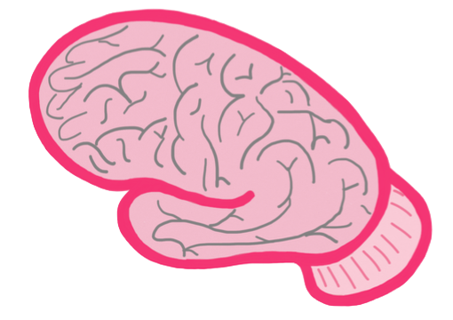

# MITTENS

**M**athematical solution for **I**ntervoxel **T**ract **T**ransition
**E**xpectations requiring **N**o **S**imulations.

MITTENS computes the probability that a white-matter fiber leaving a voxel
enters each of its 26 neighbors, in closed form, from that voxel's
orientation distribution function (ODF). See Cieslak et al. (2018),
[*Analytic tractography*](https://doi.org/10.1016/j.neuroimage.2017.12.039),
NeuroImage 169:473–484.

Version 2 is a rewrite: a small Rust core (PyO3) replaces the generated
Fortran, all file formats go through [odx](https://github.com/PennLINC/odx-rs),
and voxel-graph tractography runs on [igraph](https://python.igraph.org)
instead of networkit.

## What's new in v2

- **No precompiled geometry.** A fiber is a sequence of fixed-length hops.
  For each sequence, the starting points that exit into a given neighbor
  form an axis-aligned box with an exact volume. v1 shipped these volumes as
  ~250k lines of generated Fortran for one sphere, step size and angle
  (odf8, √3/2, 35°). v2 enumerates them at runtime in milliseconds for any:
  - sphere and step size
  - maximum angle or turning prior
  - voxel shape, including anisotropic and oblique voxels
- **Exact in float64.** v1's literals had no `d0` kind suffix, so gfortran
  rounded every coefficient to float32 (relative error up to 6e-8). v2
  reproduces every v1 coefficient to 1e-12.
- **SH input without resampling.** Spherical-harmonic coefficients are
  evaluated on the quadrature sphere inside the kernel. You can use a sphere
  denser than odf8 with `TransitionModel(sphere=1281)`, and memory stays
  proportional to the number of SH coefficients.
- **FOD amplitudes are used.** v1 renormalized every ODF to sum to one, so a
  CSF voxel and dense white matter sent the same total probability to their
  neighbors. v2's stop-mass model adds a "stop" outcome of weight `tau` to
  every hop choice, so weak FOD support terminates fibers. With `tau=0`
  results are identical to v1.
- **Asymmetric ODFs.** The full signed sphere is the default. Symmetric data
  is folded onto a hemisphere only as a speed-up. Inputs can be full-basis
  (odd-order) SH or pyAFQ aODFs.
- **Voxel graphs on igraph.** Most probable paths between regions, path
  probability maps, atlas connectivity, betweenness and maximum flow. Graphs
  are built from the probabilities in one vectorized step and work on the
  data's own voxel grid and affine.

## Installation

The distribution is named `mittens-dmri`, because `mittens` on PyPI is an
unrelated word-embedding package. The import name is still `mittens`.

```bash
pip install maturin
maturin develop --release   # from a clone of this repository
```

This needs a Rust toolchain ([rustup](https://rustup.rs)) and installs
`numpy`, `scipy`, `nibabel`, `odx` and `igraph`.

## Quick start

```python
from mittens import TransitionModel, load_odf_data

data = load_odf_data("sub-01_dwimap.odx")    # or .fib.gz / .fz, or an odx.Odx
model = TransitionModel()                    # v1 defaults: step √3/2 voxel, 35°
result = model.fit(data)

result.single          # (N, 26) single-ODF transition probabilities
result.double          # (N, 26) double-ODF, sub-stochastic
result.codi_single     # compositional distance from isotropic (CoDI)
result.neighbor_labels # e.g. "ras" for right-anterior-superior
result.to_nifti("sub-01")       # 4D NIfTIs + JSON sidecar
result.to_odx("sub-01_mittens.odx")
```

Columns follow `mittens.neighbor_offsets()`, the 26 index-space offsets
`(di, dj, dk)` in lexicographic order. Rows follow `data.ijk`.

### Choosing the geometry

```python
TransitionModel(step_mm=1.8, angle_max=35)        # explicit step and angle
TransitionModel(min_radius_mm=2.5)                # same fiber curvature at any resolution
TransitionModel(turning="vmf", persistence_length_mm=10.0)  # worm-like-chain prior
TransitionModel(sphere=1281)                      # SH data on a 2562-direction sphere
```

With the v1 parameters the step is in voxels. The implied minimum radius of
curvature is 1.44 voxels, so the physical fiber model changes with
resolution. Use `min_radius_mm` to hold it fixed.

### Using FOD amplitudes

```python
result = TransitionModel(tau=0.1).fit(data)
result.p_terminate_single      # probability a fiber stops in each voxel
```

`tau` is in per-direction amplitude units, and it is compared with the
*mean* amplitude over the turning cone, not with a peak. Useful values are
therefore much smaller than iFOD2's peak cutoff. For one mtnormalised
MSMT-CSD subject (2 mm), the mean amplitude in white matter is about 0.05,
and `tau=0.003` stops about 9% of the mass in dense white-matter voxels.
`tau` is only meaningful when amplitudes are comparable across voxels.

## Voxel-graph tractography

```python
from mittens import VoxelGraph

vg = VoxelGraph.from_transitions(result, model="double")
vg = vg.mask("wm_mask.nii.gz")          # keep only these voxels
vg.add_atlas("atlas.nii.gz")            # regions can now be atlas labels

sp = vg.shortest_paths_from(17)         # most probable path from region 17 to every voxel
vg.to_nifti(sp.mean_probability, "from17_mean.nii.gz")
vg.to_nifti(sp.backprop(sp.mean_probability), "from17_backprop.nii.gz")

to53 = vg.shortest_paths_to(53)         # from every voxel to region 53
vg.save_streamlines(to53.paths(vg.region_nodes(17)), "17_to_53.tck")

conn = vg.atlas_connectivity()          # region x region path scores
```

Each edge `u -> v` stores a probability `p` and a length `-log p`, so a
shortest path is the most probable chain of voxel-to-voxel moves.
`weights` chooses `p`:

- `"transition probability"`: `P(u -> v)` (default);
- `"minus_iso"`: the part of `P(u -> v)` above an isotropic ODF's;
- `"minus_iso_scaled"`: the same, rescaled so each voxel's edges sum to 1.

Regions are atlas labels, NIfTI files or images on the ODF grid, or
arrays. For every voxel, `ShortestPaths` gives the path probability, its
geometric mean per move, the probability of the same moves under isotropic
ODFs (`null_probability`), the number of moves, and the path itself.
`vg.components()`, `vg.betweenness(n_samples=500)` and
`vg.max_flow(source, sink)` cover the rest of v1's graph measures.
`vg.graph` is the same graph as an `igraph.Graph`, in the same edge order,
for any other igraph algorithm (pass `weights=vg.length`).

Changes from v1's `VoxelGraph`:

- Every graph stores both `p` and `-log p`, so the separate
  `*_negative_log` weighting schemes are gone.
- The mean path probability is the geometric mean per move. v1 divided by the
  number of path nodes, including a virtual source node.
- `shortest_paths_to` follows edges from each voxel toward the target
  region. v1's region-to-region query searched outward from the target.
- Graphs are saved as `.npz`, not `.mat`.
- `AtlasGraph` duplicated `VoxelGraph` and was removed. Also removed:
  `EnvironmentMatch` (its fixel similarity was a placeholder), the nipype
  interfaces, Katz centrality, spanning forests and plotting. igraph's
  centralities and spanning trees are available on `vg.graph`.

## Development

```bash
cargo test -p mittens-core --release
maturin develop --release && pytest
```

- `tests/test_legacy_golden.py` checks the runtime path table against every
  coefficient of the v1 Fortran. The coefficients were extracted by
  `tests/data/extract_legacy_golden.py`.
- `tests/test_kernel_oracle.py` checks the kernel against an independent
  numpy implementation of v1's formulas.
- `tests/test_voxel_graph.py` checks shortest paths against
  `scipy.sparse.csgraph`, and max flow against the min-cut theorem.
- A Monte Carlo simulation of the hop process (slow test, `-m "not slow"`
  skips it) checks that the closed-form probabilities are exact.

`validation/streamline_ground_truth.py` scores MITTENS against a tractogram.
It builds FODs from the streamlines and uses the same streamlines as ground
truth; results for the TRXScan sub-60501 phantom are in
[`validation/README.md`](validation/README.md).
